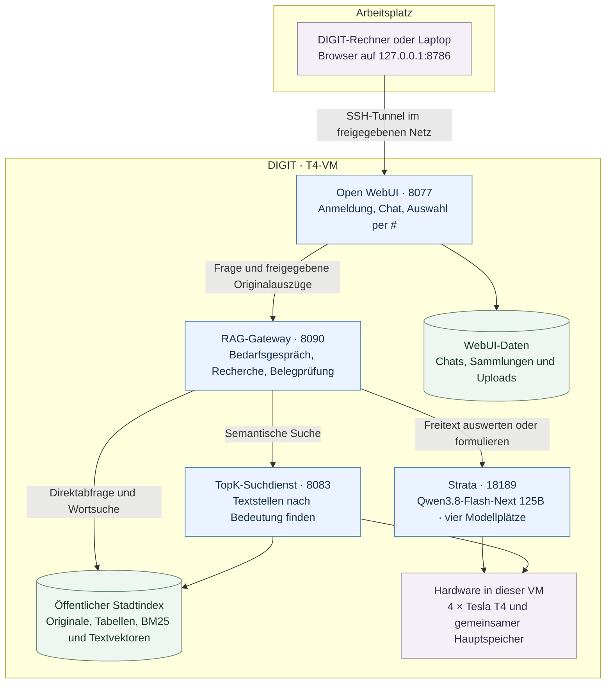

# Agentic RAG DIGITOM

Der **DIGITOM-Bedarfsassistent** hilft einem Fachamt, aus einem Anliegen einen prüfbaren Bedarf zu machen. Im Beispiel möchte der Außendienst kaputte Spielgeräte per Handy mit Foto und Standort melden. Der Assistent sucht einen bestehenden Service und dessen verantwortliches Team, zeigt einen ähnlichen früheren Fall und fragt nach Empfänger und Erfolgskriterium. Aus dem Gespräch entsteht ein **Steckbrief mit anklickbaren Originalquellen**. Er bleibt im jeweiligen Open-WebUI-Chat. Über die fachliche Freigabe und die Übernahme nach KIX oder Confluence entscheidet das Team.

Die vier mitgelieferten Übungsunterlagen sind **synthetisch**. Für die Arbeit mit eigenen Daten legt ein Admin eine Wissenssammlung an, vergibt Leserechte und wählt sie im Chat mit `#` aus. Das Modell **Freiburger Stadtdaten** in derselben Oberfläche beantwortet Bürgerfragen aus einem eigenen öffentlichen Stadtindex. [Vorführung in zwei Nachrichten](demo/MORGEN.md)

## Was läuft wo?

Jeder große Rahmen ist ein Rechner. Alle vier Serverdienste befinden sich **gemeinsam auf einer Linux-VM**. Die kleinen Kacheln innerhalb der VM sind Prozesse und Speicherorte. Ein Pfeil zeigt, welcher Prozess mit welchem spricht.



| Kachel | Aufgabe im Beispiel |
|---|---|
| Open WebUI | Prüft die Leserechte und übergibt nur zugängliche Auszüge der ausgewählten Sammlung mit einer Signatur an das Gateway. Hier lassen sich Quellen öffnen und Chats wiederfinden. |
| RAG-Gateway | Ordnet den Bedarf einem Service zu, unterscheidet Katalogwissen von Angaben der fragenden Person und fragt nach fehlenden Angaben. Im Stadtchat kann es eindeutige Zahlen direkt aus der Originaltabelle lesen. |
| TopK und Stadtindex | Finden öffentliche Textstellen in Freiburg. Der Gateway kombiniert Wortsuche und Vektortreffer und bewertet Kandidaten mit BGE. Eigene `#`-Sammlungen werden in Open WebUI getrennt gespeichert und durchsucht. |
| Strata und die vier T4 | Halten Qwen in der Quantisierung `UD-Q4_K_XL` bereit. Freier Quelltext kann so ausgewertet werden. Strukturierte Katalogeinträge und eindeutige Tabellenzellen verarbeitet die Anwendung direkt. Die vier Modellplätze teilen sich die Hardware. |

## Morgen auf den T4 installieren

Als vorgesehener **Linux-Benutzer der VM**, mit Lesezugriff auf dieses private Repository:

```bash
git clone https://github.com/coderizon/agentic-rag-digitom.git && cd agentic-rag-digitom && bash setup.sh
```

**Für die Vorführung mit dem getesteten Datenstand** die Datei `stadt-20261124.tar.gz` vorab ins Home-Verzeichnis des VM-Benutzers kopieren. Der Installationsbefehl findet sie dort. Für einen anderen Speicherort gilt `bash setup.sh --snapshot /pfad/stadt-20261124.tar.gz`. Bei einer Erstinstallation ohne Archiv lädt der Installer die öffentlichen Quellen erneut und baut die Indizes auf. Dafür braucht er zusätzlich Tesseract mit dem deutschen Sprachpaket. Der geprüfte Snapshot enthält 2.149 Quellen, 5.411 Textpassagen und 48 Bildseiten. [Prüfsumme, Quellenstand und Modellversionen](ops/provenance.json)

**Vor dem Download prüfen:** `bash setup.sh --check`. Voraussetzung sind Linux x86_64, vier derselben VM zugewiesene T4, ein für die Strata-Engine geeigneter CUDA-13-Treiber und ungefähr 200 GB freier persistenter Speicher für eine Erstinstallation. Zum Herunterladen werden die in der [Betriebsanleitung für Agenten](AGENTS.md) genannten Quellen benötigt. Auf der gemieteten Referenz-VM standen rund 483 GiB RAM bereit. Die tatsächliche Zuteilung in Freiburg prüft ihr vor Ort.

Der Installer richtet getrennte Python-Laufzeiten ein, prüft das Modell und die Daten, erstellt lokale Dienstschlüssel und startet alle vier Dienste. Im Terminal legt ihr das erste Open-WebUI-Administratorkonto an oder meldet euch mit einem bestehenden an. Abschließend prüft das Skript zehn Punkte im echten Chat, einschließlich Folgefrage und Originalquellen. Standard-Ziel ist `~/.local/share/agentic-rag-digitom`. Mit `FREIBURG_ROOT=/daten/digitom bash setup.sh` wählt ihr ein anderes beschreibbares, persistentes Verzeichnis.

## Vom Arbeitsplatz öffnen

```bash
ssh -N -L 127.0.0.1:8786:127.0.0.1:8077 BENUTZER@VM
```

`BENUTZER@VM` durch den freigegebenen DIGIT-Zugang ersetzen. Vom Laptop muss die VM über einen genehmigten Netzweg erreichbar sein, etwa per VPN. Dann [Open WebUI auf dem Arbeitsplatz öffnen](http://127.0.0.1:8786/) und **DIGITOM · Bedarfsassistent** auswählen. Der Internetzugriff für die Erstinstallation und der spätere Zugriff der Nutzer sind zwei verschiedene Verbindungen.

## Betrieb und Nachweise

- [AGENTS.md](AGENTS.md) beschreibt Vorprüfung, Installation, Abnahme, Wiederanlauf und den Umgang mit echten Unterlagen.
- [BETRIEB.md](BETRIEB.md) erklärt Retrieval, UI-Einstellungen, Modellaufrufe und Einzeldienste.
- [Benchmarks mit 10, 50 und 200 parallelen Anfragen](BENCHMARKS.md) zeigen Wartezeit und Korrektheit für Bedarfsgespräche, Haushaltszahlen und freie Modellfragen. Man kann jede Messreihe bis zu den einzelnen Ergebnissen verfolgen.
- [Installationsprüfung](results/installation-git.md) hält fest, welche Teile auf dem gemieteten T4-System überprüft wurden.
